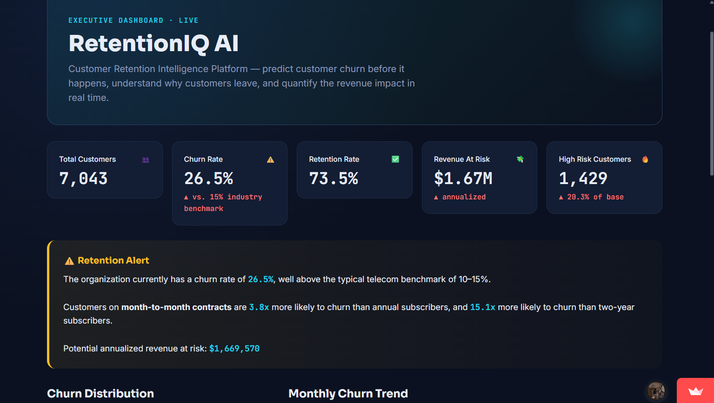
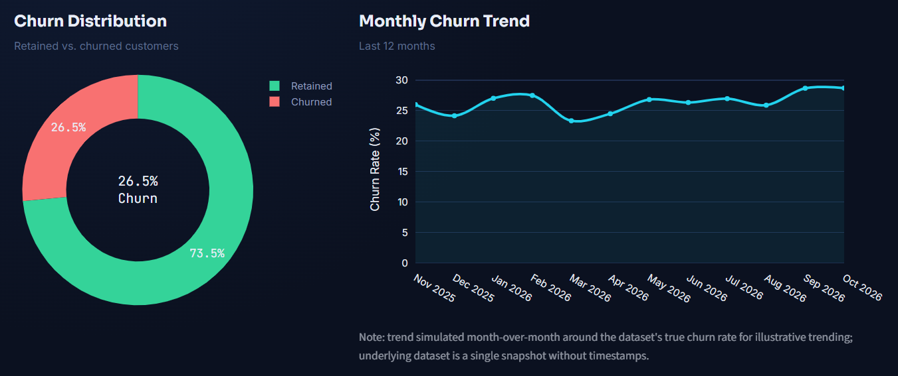
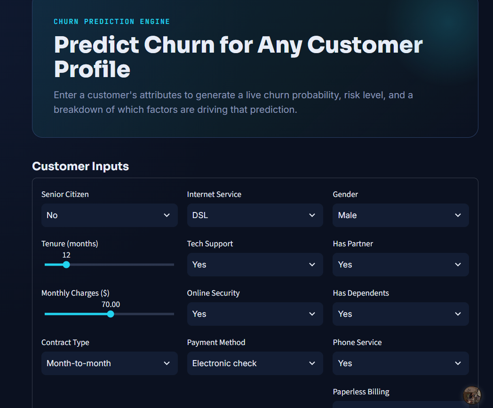

# 📊 RetentionIQ AI

### Customer Churn Prediction & Retention Intelligence Platform

Predict which customers are likely to leave, understand why, and see how much revenue is at risk, all in one interactive Streamlit app.

## 🚀 Live Demo

**[Open the live app](https://retentioniq-ai-auekhnplrdesbffqrojbcg.streamlit.app/)**

### Screenshots







---

## 🎯 Problem Statement

Customer churn directly hits revenue and lifetime value. A retention team needs to know:

* Which customers are likely to leave?
* Why are they leaving?
* How much revenue is at risk?
* What should be done to keep them?

RetentionIQ AI answers these with a predictive model plus business-focused dashboards.

## 🗂️ Dataset

Public **IBM Telco Customer Churn** dataset: **7,043 customers, 21 columns** (contract, tenure, services, billing, monthly charges, churn flag). Overall churn rate: **26.5%**.

---

## 🧠 Model & Results

A `RandomForestClassifier` (200 trees, max depth 10, class-weighted to handle the 26.5% churn imbalance) trained on an 80/20 stratified split (5,634 train / 1,409 test).

| Metric (held-out test set) | Result |
|---|---|
| ROC-AUC | **0.84** |
| Recall | **75%** |
| Accuracy | 77% |
| Precision | 55% |
| F1 | 0.63 |

**Why recall over precision?** Missing a customer who is about to leave costs more than offering a retention incentive to someone who would have stayed, so the model is tuned to catch more churners, at the cost of more false alarms (precision 55%).

**Risk tiers** (churn probability ≥ 0.7 = High, 0.4–0.7 = Medium, below 0.4 = Low) separate customers well: actual churn was about **76% in High**, **39% in Medium** and **4% in Low** risk. These tiers are scored across the whole dataset, including customers used for training, so treat them as illustrative rather than as out-of-sample results.

---

## 📈 Key Findings

* **Contract type is the strongest churn driver.** Month-to-month customers churn at **42.7%**, compared with **11.3%** on one-year and **2.8%** on two-year contracts.
* Tenure, total charges, monthly charges and online security / tech support complete the top drivers in the model's feature importance.
* **1,869 customers churned**, representing about **$139K in monthly recurring revenue**, roughly **$1.67M per year**.
* **1,429 customers are flagged High risk**, a prioritised list for retention outreach.

---

## ✨ App Pages

| Page | What it does |
|---|---|
| **Executive Dashboard** | Churn and retention rate, revenue at risk, segment insights |
| **Customer Intelligence** | Customer profiles, risk scores, risk categories |
| **Churn Prediction Engine** | Enter a customer's details and get a churn probability, risk tier and an illustrative risk-factor weighting |
| **Churn Drivers** | Feature-importance ranking of what drives churn |
| **Revenue Intelligence** | Revenue at risk and highest-exposure customers (probability × annual value) |
| **Retention Strategy Center** | Rule-based retention actions per customer profile |

> **Note:** the dataset has no timestamps, so the monthly churn trend shown in the app is a **simulated illustration** anchored to the real overall churn rate, and is labelled as such. It is not a measured trend.

---

## 🛠️ Tech Stack

Python · Pandas · NumPy · Scikit-learn · Plotly · Streamlit · Joblib · Git/GitHub

## 📂 Project Structure

```text
RetentionIQ-AI/
├── app.py                 # Executive dashboard (entry point)
├── pages/                 # Customer intelligence, prediction, drivers, revenue, strategy
├── utils/                 # data processing, model training, scoring, analytics, theme
├── data/                  # Telco dataset and scored customers
├── models/                # trained model, encoders, metrics
└── requirements.txt
```

## ▶️ Run Locally

```bash
pip install -r requirements.txt
streamlit run app.py
```

The model is trained automatically on first run if it is not already saved.

## 🔮 Future Improvements

* Per-customer explanations with SHAP (the current risk-factor chart is an illustrative weighting, not SHAP)
* Compare against gradient boosting and logistic regression baselines
* Cost-based threshold tuning using retention-offer cost vs customer value

---

## 👩‍💻 Author

**Lakshita** · MCA (Data Analytics)

[GitHub](https://github.com/stakefire99) · [LinkedIn](https://www.linkedin.com/in/lakshita-047439224/)
